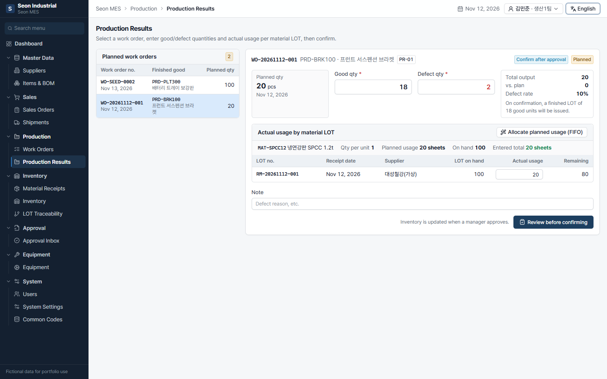

# seon-mes

A personal MES/ERP project built around a fictional auto parts maker, "Seon Industrial".
The company takes in steel sheets and makes brackets (cutting → press → inspection). The app covers sales orders, material receipts, production, approval, shipment and LOT traceability as one flow.
All partners, items, equipment and results are fictional.

Demo: https://whimsical-lamington-99ca15.netlify.app

- Public demo, so data may have been changed by other visitors.
- The first page can take a few seconds while the free Neon database wakes up.
- There is no login. Switch between operator / manager / admin from the top right.

[한국어 README](README.md)



## Features

- Master data: suppliers / customers, items, BOM
- Sales: sales orders, shipments
- Production: work orders, production results
- Inventory: receipts, stock (by item / LOT / ledger), LOT trace
- Approval: approve or reject production results
- Equipment: status, inspection / repair history
- System: users, settings, common codes
- Korean / English

Things I focused on:

- Confirming a production result (save result, issue materials, receive finished goods, write ledger, close work order) runs in one transaction.
- With approval enabled, that transaction runs when a manager approves. If stock ran short in the meantime it rolls back and the request stays pending.
- LOT stock is decremented with a conditional `UPDATE ... WHERE qty >= n`, so concurrent work can't push it negative. There is also a `CHECK (qty >= 0)` constraint.
- Duplicate confirmation is blocked by a unique constraint, duplicate approval requests by a partial unique index, and concurrent shipments by locking the sales order row.

These cases are covered by integration tests that send concurrent requests against a real PostgreSQL database (`backend/tests`).

## Demo flow

After seeding, raw material MAT-SPCC12 has no stock and there is an open order SO-SEED-0002 (18 brackets).

1. Receive 100 sheets of MAT-SPCC12.
2. Open SO-SEED-0002 and create a work order (qty 20, equipment PR-01).
3. Enter the result (good 18, defect 2, 20 sheets used) and request approval.
4. Switch to the manager in the header and approve it.
5. Check stock: 80 sheets, 18 brackets.
6. Ship 18 against the order.
7. Trace the finished LOT back to the sheet LOT and supplier, and forward to the customer.

A finished example is available as `FG-SEED-0001` in LOT trace.

## Stack

React 19, TypeScript, Vite, TanStack Router / Query, Tailwind CSS, shadcn/ui, React Hook Form, Zod, i18next, Express 5, Prisma, PostgreSQL 16, Netlify (Functions) + Neon, Vitest, Playwright

## Run locally

Requires Node.js 20.19+ and Docker Desktop.

```bash
git clone https://github.com/inha915/seon-mes.git
cd seon-mes
npm install
cp .env.example backend/.env   # PowerShell: Copy-Item .env.example backend\.env
npm run db:up
npm run db:migrate
npm run db:seed
npm run dev
```

Web: http://localhost:5173, API: http://localhost:4000/api/health

Other commands: `npm run typecheck`, `npm test`, `npm run build`, `npm run i18n:check`, `npm run db:reset` (deletes data), `npm run e2e`

## TODO

Login / permissions, cancelling and correcting results and shipments, per-process results, multi-step approval, multi-line sales orders, barcode labels, CI
