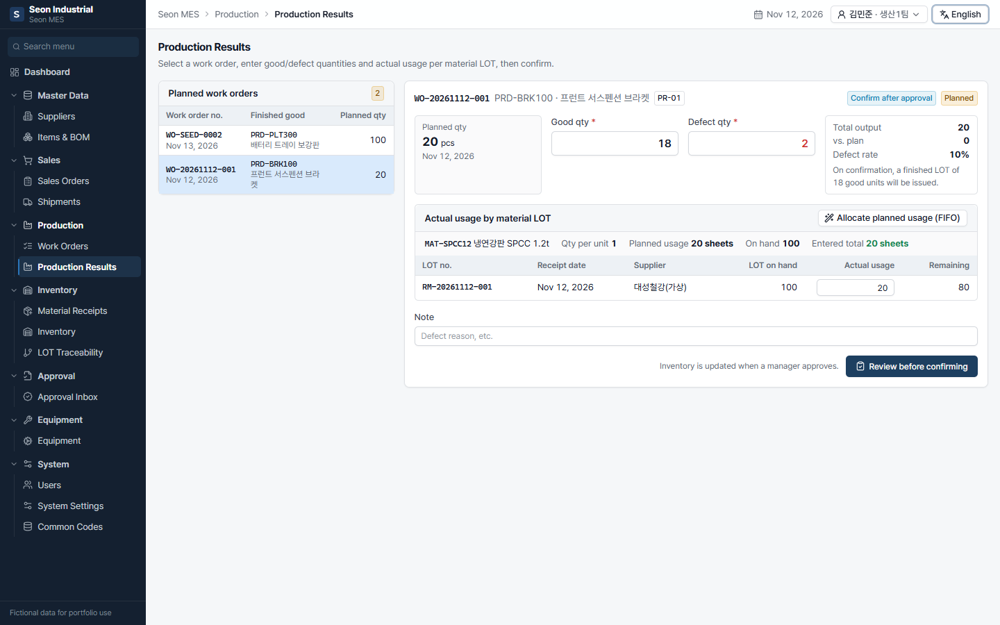
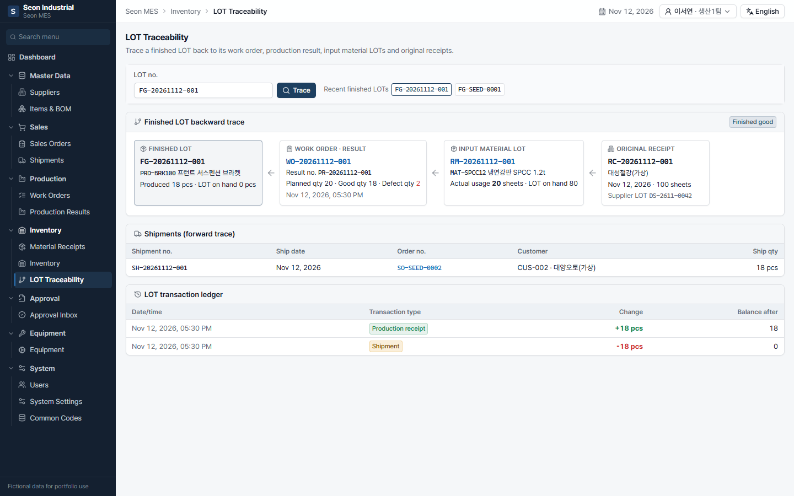
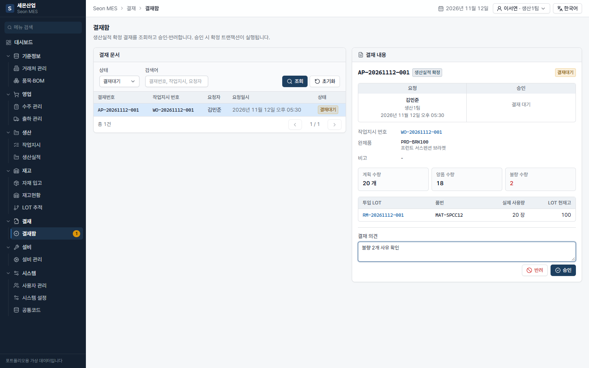
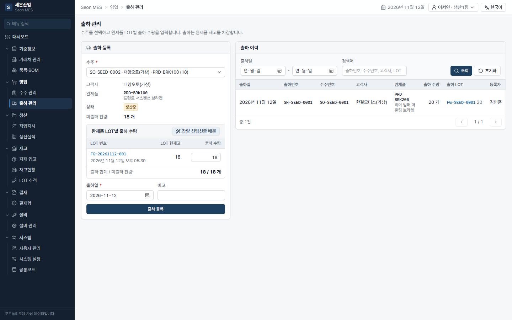
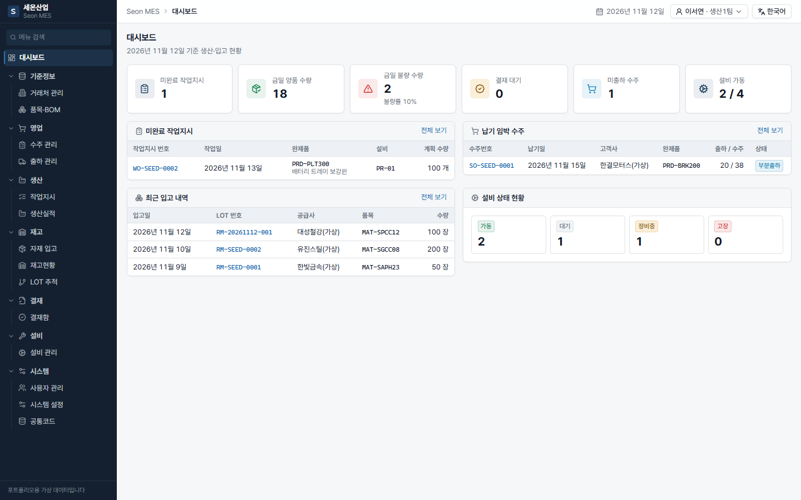
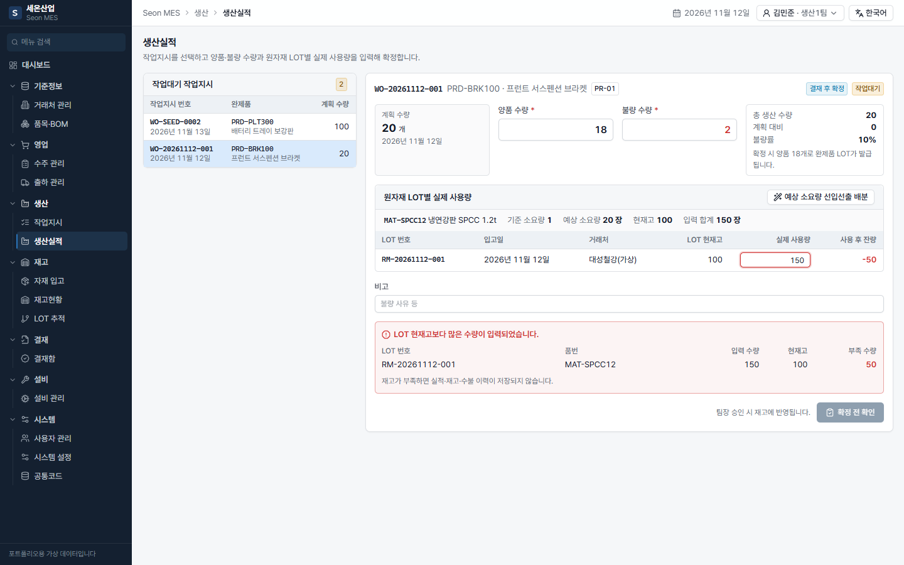

# Seon Industrial MES/ERP (seon-mes)

**English** | [한국어](README.md)

> A personal full-stack portfolio project for **Seon Industrial**, a fictional automotive parts manufacturer, covering sales orders, material receiving, production, approval, shipment and LOT traceability.
> All suppliers, customers, items, equipment, work orders, results and users are **fictional data**.

## Overview

Seon Industrial is a fictional tier-2 supplier that buys steel sheets and makes brackets through `sheet cutting → press forming → inspection`.
The system handles one end-to-end flow: **sales order → material receipt (internal LOT issued) → work order linked to the order → production result with actual usage per LOT → manager approval confirms it (material issue + finished LOT receipt) → shipment → LOT traceability from receipt to customer**.
Every stock-changing operation (confirmation, approval, shipment) runs in **one database transaction**, and duplicate confirmation, concurrent consumption of the same LOT and concurrent shipments are prevented with DB constraints, conditional updates and row locks.
The UI follows the layout of Korean manufacturing ERPs — a **left tree menu (Master Data · Sales · Production · Inventory · Approval · Equipment · System)** — in Korean and English.

## Screenshots

All screenshots were captured from a real local run by the E2E script (`npm run screenshots`).

| Production results (English) | LOT traceability (English) |
|---|---|
|  |  |
| **Approval inbox** — approval runs the confirmation transaction | **Shipments** — ship per finished LOT (FIFO allocation) |
|  |  |
| **Dashboard** | **Insufficient stock** — short LOTs shown, blocked |
|  |  |

## Menu

| Domain | Modules |
|---|---|
| Master Data | Suppliers & customers, Items & BOM |
| Sales | Sales orders (detail: linked work orders, available LOTs, shipments), Shipments |
| Production | Work orders (linked to sales orders, equipment assignment), Production results (approval request) |
| Inventory | Material receipts, Stock (by item / LOT / ledger), LOT traceability |
| Approval | Approval inbox (approve / reject / cancel) |
| Equipment | Equipment (status changes, inspection/repair history) |
| System | Users & roles (demo user switch, no login), System settings, Common codes |

## Demo scenario

After seeding, raw material **MAT-SPCC12 has zero stock** and there is an open sales order **SO-SEED-0002 (18 brackets)**. The header user starts as an **operator**.

1. **Material Receipts** — supplier `SUP-001`, `MAT-SPCC12`, qty `100` → LOT `RM-YYYYMMDD-001`.
2. **Sales Orders** → SO-SEED-0002 → **Create work order** → planned qty `20`, equipment `PR-01` (equipment under maintenance cannot be selected) → order becomes *In production*.
3. **Production Results** — good `18`, defect `2`, usage `20` (enter `150` to see the shortage panel) → **Request approval**. Stock does not change yet.
4. **Approval Inbox** — the operator cannot approve; switch to the **manager** in the header and approve → result confirmed, 20 sheets issued, finished LOT `FG-YYYYMMDD-001` (18 pcs).
5. **Stock** — sheets **80**, brackets **18**.
6. **Shipments** — SO-SEED-0002 → FIFO allocation → ship 18 → order *Shipped*.
7. **LOT Traceability** — finished LOT ← work order/result ← sheet LOT ← original receipt, and shipments → customer.

A seeded completed case is also available: `FG-SEED-0001` (`SO-SEED-0001` → `WO-SEED-0001` → approval `AP-SEED-0001` → 38 produced → 20 shipped).

## Tech stack and structure

React 19 · TypeScript · Vite 7 · TanStack Router · TanStack Query · Tailwind CSS 4 · shadcn/ui · React Hook Form · Zod · i18next ·
Node.js · Express 5 · PostgreSQL 16 · Prisma 6 · npm workspaces · Docker Compose · Vitest · Playwright

- Backend: `backend/src/modules/<domain>/<module>/` — `*.routes.ts` (HTTP + Zod) and `*.service.ts` (business rules); shared `lib/stock.ts` (conditional LOT decrement)
- Frontend: `src/app` (router, menu tree, layout) · `src/modules/<domain>/<module>` (screens + Query hooks) · `src/shared` (`ui` primitives, ERP components such as `SearchPanel`, `DataGrid`, `Panel`, `CodeBadge`; code registry `codes.ts`) · `src/styles` (design tokens + ERP component classes)
- The menu (`app/menu.ts`), URL (`/sales/orders`) and folder (`modules/sales/orders`) mirror each other.

## Running locally (Windows PowerShell)

Prerequisites: **Node.js ≥ 20.19** (verified with 24.14.1), **Docker Desktop**, Git.

```powershell
git clone https://github.com/inha915/seon-mes.git
cd seon-mes
npm install                               # installs both workspaces, generates Prisma Client
Copy-Item .env.example backend\.env       # on macOS/Linux: cp .env.example backend/.env
npm run db:up                             # PostgreSQL for seon-mes on host port 5433
npm run db:migrate                        # apply migrations
npm run db:seed                           # demo data (safe to re-run, no duplicates)
npm run dev                               # API + web
```

- Web: http://localhost:5173 · API: http://localhost:4000/api (health: `/api/health`)
- Other root commands: `npm run typecheck`, `npm run build`, `npm test`, `npm run i18n:check`, `npm run db:reset` (**deletes data**), `npm run e2e`, `npm run screenshots`

## Key design points

- **Confirmation** is split into `precheckProduction` (BOM membership, stock shortages — no writes) and `confirmProductionTx` (claim work order, insert result with `work_order_id UNIQUE`, conditionally decrement LOTs in id order, issue a finished LOT only when good > 0).
- **Approval**: requesting runs the same precheck; approving (manager/admin only) updates the approval and runs `confirmProductionTx` in one transaction. If stock ran short in the meantime, everything rolls back and the request stays pending. A partial unique index allows only one pending approval per work order.
- **Concurrency**: `UPDATE lots SET qty = qty - n WHERE id = ? AND qty >= n` (shared by production and shipments) re-evaluates against the latest row under READ COMMITTED; shipments lock the sales order row (`SELECT … FOR UPDATE`) so concurrent shipments cannot exceed the order; `CHECK (qty >= 0)` is the final guard.
- **Verified** (2026-11-12, local): 27 backend integration tests on real PostgreSQL (e.g. 5 concurrent confirms → 1 success; 6 concurrent 30-sheet consumptions of a 100-sheet LOT → 3 successes; 3 concurrent approval requests → 1; 4 concurrent 10-pc shipments on a 25-pc order → 2) and 30 browser E2E checks.
- **i18n**: the server returns fixed codes plus values in `details`; the frontend code registry maps codes to `codes.<group>.<CODE>` keys and badge tones. `npm run i18n:check` verifies key/placeholder parity and translations for every API error code and Prisma enum value (currently 496 keys per language, 84 code mappings).
- **Adding a language**: copy `ko.json` to `<code>.json`, register it in `SUPPORTED_LANGUAGES` and `resources` in `frontend/src/i18n/index.ts`, then run `npm run i18n:check`.

## Roadmap

Implemented: master data, sales orders & shipments, work orders with equipment, production results with approval-gated confirmation, duplicate/concurrency protection, stock & ledger, two-way LOT traceability, equipment history, users & settings, common codes, live dashboard, ko/en.
Planned: authentication, cancellation/correction (reversing entries), per-process results, multi-step approval lines, multi-line sales orders, equipment integration, barcode labels, POP tablet UI, CI and cloud deployment (Netlify config included, not deployed).
