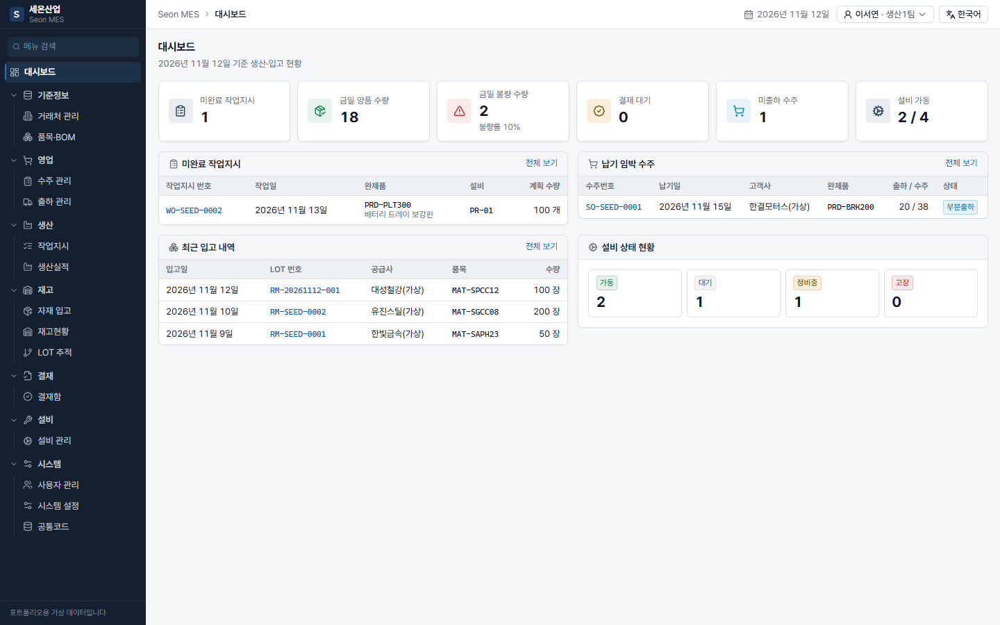
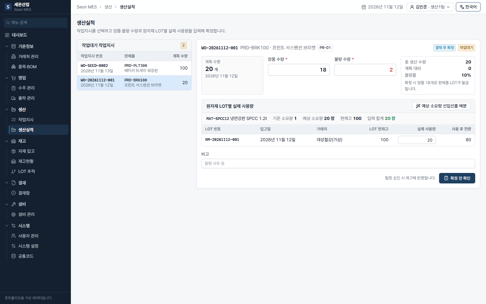
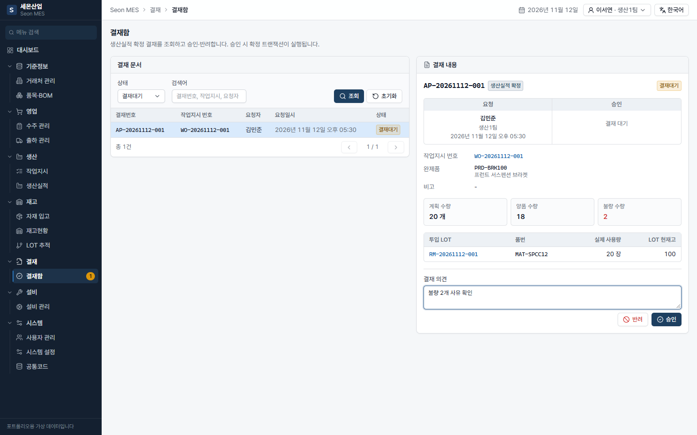
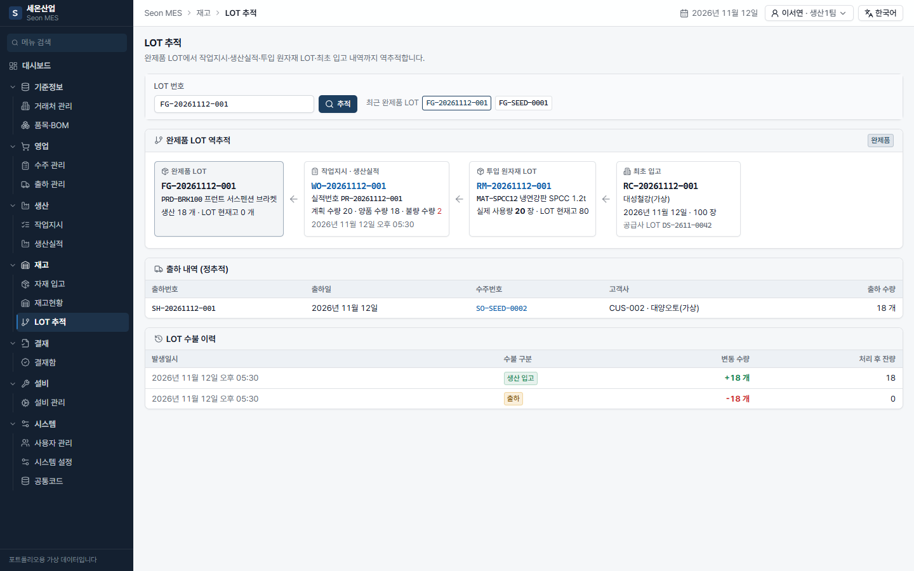
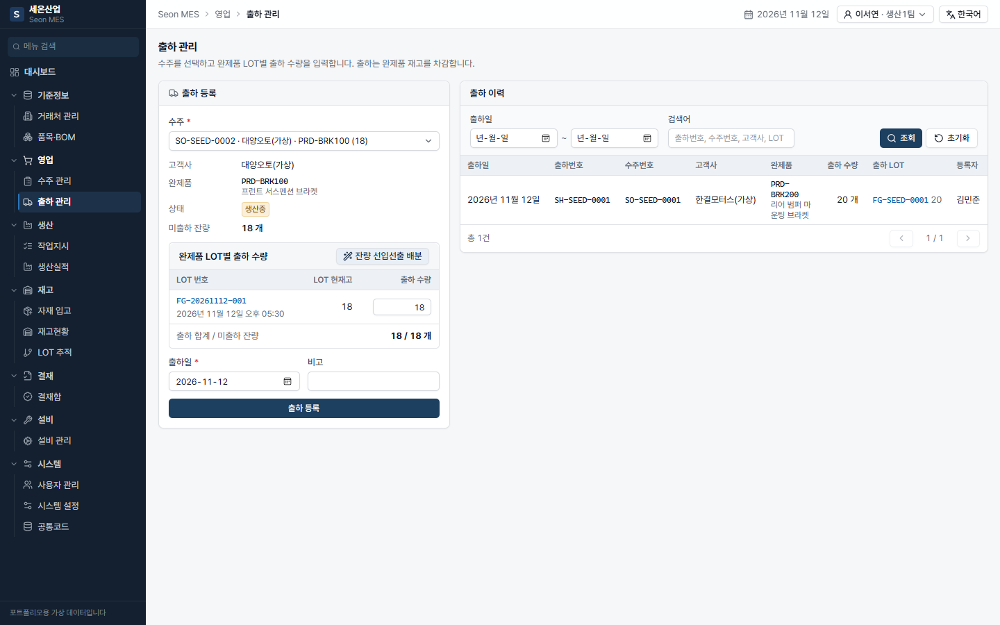
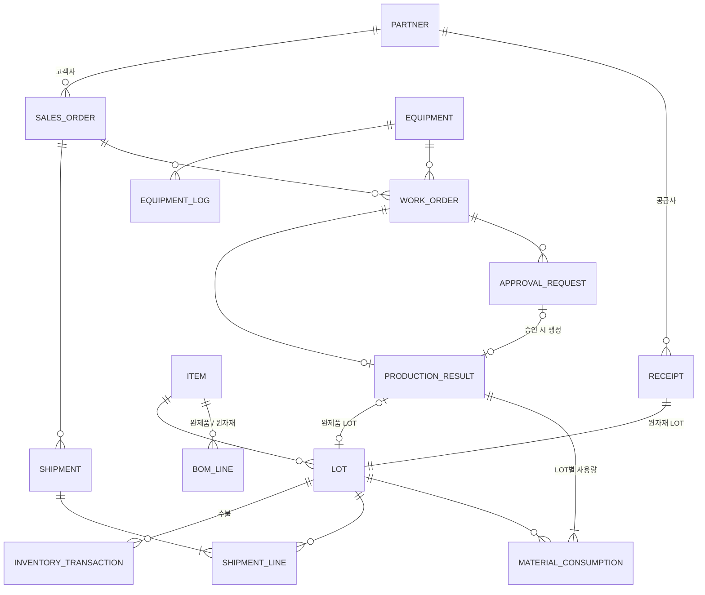

# seon-mes

가상의 자동차 부품 회사 "세온산업"을 기준으로 만든 MES/ERP 개인 프로젝트입니다.
강판을 받아서 절단 → 프레스 → 검사를 거쳐 브라켓을 만드는 회사라고 가정했고, 수주부터 입고, 생산, 결재, 출하, LOT 추적까지 한 흐름으로 이어지게 만들었습니다.
거래처, 품목, 설비, 실적 데이터는 전부 가상 데이터입니다.

데모: https://whimsical-lamington-99ca15.netlify.app

- 누구나 입력할 수 있는 공개 데모라 데이터가 바뀌어 있을 수 있습니다.
- DB(Neon 무료 플랜)가 잠들어 있으면 첫 화면이 몇 초 늦게 뜹니다.
- 로그인은 없고, 우측 상단에서 사용자(작업자 / 팀장 / 관리자)를 바꿔가며 써볼 수 있습니다.

[English README](README.en.md)



## 기능

메뉴는 실제로 회사에서 쓰는 ERP처럼 좌측 트리로 나눴습니다.

- 기준정보: 거래처(공급사/고객사), 품목, BOM
- 영업: 수주, 출하
- 생산: 작업지시, 생산실적
- 재고: 자재입고, 재고현황(품목별/LOT별/수불), LOT 추적
- 결재: 결재함 (생산실적 승인/반려)
- 설비: 설비 상태, 점검/수리 이력
- 시스템: 사용자, 시스템 설정, 공통코드

신경 쓴 부분은 재고가 틀어지지 않게 하는 것입니다.

- 생산실적 확정 시 실적 저장, 원자재 차감, 완제품 입고, 수불 기록, 작업지시 완료를 한 트랜잭션으로 처리
- 결재를 켜두면 팀장이 승인하는 순간 위 트랜잭션이 실행되고, 그 사이 재고가 부족해졌으면 롤백 후 결재는 대기로 남음
- 같은 LOT를 여러 작업에서 동시에 써도 음수가 안 되게 조건부 UPDATE 사용
- 같은 작업지시 중복 확정은 unique 제약으로 막음
- 한국어 / 영어 지원 (상태값, 오류 코드는 서버에서 코드로 내려주고 화면에서 번역)

| 생산실적 입력 | 결재함 |
|---|---|
|  |  |
| LOT 추적 | 출하 |
|  |  |

나머지 화면: [입고](docs/images/01-receipts.png), [수주](docs/images/02-sales-orders.png), [작업지시](docs/images/03-work-orders.png), [재고부족 표시](docs/images/04-production-shortage.png), [재고현황](docs/images/06-inventory.png), [수불이력](docs/images/06-inventory-ledger.png), [설비](docs/images/09-equipment.png), [공통코드](docs/images/10-codes.png), [영어 화면](docs/images/04-production-en.png)

## 데모 순서

시드를 넣으면 냉연강판(MAT-SPCC12) 재고는 0이고, 대양오토 수주(SO-SEED-0002, 브라켓 18개)가 하나 접수돼 있습니다.

1. 재고 > 자재입고: 대성철강에서 냉연강판 100장 입고 → 내부 LOT 발급
2. 영업 > 수주관리 > SO-SEED-0002 > 작업지시 생성: 수량 20, 설비 PR-01 (정비중인 PR-02는 선택 안 됨)
3. 생산 > 생산실적: 양품 18 / 불량 2, 강판 20장 투입 후 결재 요청 (사용량에 150을 넣으면 재고 부족 표시)
4. 결재 > 결재함: 작업자로는 승인 버튼이 안 보임 → 우측 상단에서 이서연(팀장)으로 바꾸고 승인
5. 재고 > 재고현황: 강판 80장, 브라켓 18개 확인
6. 영업 > 출하관리: 18개 출하
7. 재고 > LOT 추적: 완제품 LOT → 작업지시 → 강판 LOT → 입고 거래처, 그리고 출하된 고객까지 확인

이미 끝까지 진행된 예시는 LOT 추적에서 `FG-SEED-0001`을 조회하면 볼 수 있습니다.

## 기술 스택

- Frontend: React 19, TypeScript, Vite, TanStack Router / Query, Tailwind CSS, shadcn/ui, React Hook Form, Zod, i18next
- Backend: Node.js, Express 5, TypeScript, Zod, Prisma
- DB: PostgreSQL 16 (로컬은 Docker, 배포는 Neon)
- 배포: Netlify (프론트 + Netlify Functions로 Express 실행)
- 테스트: Vitest (실제 PostgreSQL로 통합 테스트), Playwright (E2E)

## 폴더 구조

```text
backend/
  prisma/              schema, migrations, seed
  src/
    module/            기능별 폴더 (router / controller / service)
      master/          partners, items
      sales/           orders, shipments
      production/      work-orders, results
      inventory/       receipts, stock, lots
      approval/
      equipment/
      system/          users, settings
      dashboard/
    middleware/        validate, errorHandler
    lib/               errors, zod, stock(재고 차감), sequence(채번), currentUser
  tests/
frontend/src/
  app/                 router, menu(메뉴 트리), layout
  modules/             화면 + api 훅 (메뉴 구조와 동일하게)
  shared/              공통 컴포넌트(DataGrid, SearchPanel, Panel...), codes, lib
  styles/              theme.css(색상 토큰), components.css
  i18n/locales/        ko.json, en.json
netlify/               functions/api.ts, plugins/slim-function-deps
scripts/e2e-demo.mjs   데모 시나리오 E2E + 스크린샷
```

## 로컬 실행

Node.js 20.19 이상, Docker Desktop이 필요합니다. (Windows PowerShell 기준)

```powershell
git clone https://github.com/inha915/seon-mes.git
cd seon-mes
npm install
Copy-Item .env.example backend\.env
npm run db:up
npm run db:migrate
npm run db:seed
npm run dev
```

- 웹: http://localhost:5173
- API: http://localhost:4000/api/health
- DB: localhost:5433 (기존에 설치된 PostgreSQL이랑 안 겹치게 5433 사용)

macOS / Linux는 `Copy-Item` 대신 `cp .env.example backend/.env`.

자주 쓰는 명령

```bash
npm run typecheck
npm test            # 백엔드 통합 테스트 + 번역 키 테스트
npm run build
npm run i18n:check  # ko/en 키 누락, 오류코드/enum 번역 누락 검사
npm run format
npm run db:reset    # DB 초기화 후 다시 시드 (데이터 삭제됨)
npm run e2e         # 시드 직후 DB + npm run dev 상태에서 실행
```

환경변수(`backend/.env`)는 `.env.example` 참고. 테스트는 `TEST_DATABASE_URL`의 별도 DB를 쓰고 시작할 때 테이블을 비웁니다.

## 데이터 구조



- BOM은 작업지시의 예상 소요량 계산에만 쓰고, 실제 재고는 실적에 입력한 LOT별 사용량으로 차감합니다.
- 현재고는 `lots.qty`, 증감 내역은 `inventory_transactions`에 처리 후 잔량과 같이 남깁니다.
- 문서번호(LOT, 입고, 수주, 출하, 작업지시, 실적, 결재)는 `document_sequences`에서 `INSERT ... ON CONFLICT DO UPDATE`로 채번합니다.

## 구현하면서 정리한 것

**실적 확정 / 결재**

`production.service.ts`에서 확정 로직을 검사(`precheckProduction`)와 실행(`confirmProductionTx`)으로 나눴습니다.
결재 요청할 때는 검사만 돌리고, 승인할 때 결재 상태 변경과 `confirmProductionTx`를 같은 트랜잭션 안에서 실행합니다.
결재를 끄면 같은 함수를 바로 호출합니다.

**동시성**

- 재고 차감은 `UPDATE lots SET qty = qty - n WHERE id = ? AND qty >= n` 형태로 처리합니다. READ COMMITTED에서 뒤에 들어온 트랜잭션은 앞 트랜잭션이 끝날 때까지 기다린 다음 바뀐 값으로 조건을 다시 보기 때문에 음수가 되지 않습니다. 생산 투입과 출하가 같이 씁니다 (`lib/stock.ts`).
- 그래도 혹시 몰라서 `lots.qty`에 `CHECK (qty >= 0)`을 걸어뒀습니다.
- 작업지시 중복 확정: `status = 'PLANNED'` 조건으로 먼저 선점하고, `production_results.work_order_id`에 unique.
- 결재 중복 요청: `WHERE status = 'PENDING'` 부분 unique 인덱스로 작업지시당 대기 결재 1건만.
- 동시 출하: 출하 시작할 때 수주 행을 `SELECT ... FOR UPDATE`로 잠그고 잔량을 확인.
- 여러 LOT를 쓰는 경우 LOT id 순서로 차감해서 데드락을 피합니다.

위 케이스들은 `backend/tests`에 실제 DB로 동시 요청을 보내는 테스트로 넣어뒀습니다. (예: 100장 LOT에 30장씩 6건 동시 확정 → 3건만 성공하고 잔량 10)

**다국어**

- DB 상태값과 API 오류는 `COMPLETED`, `INSUFFICIENT_STOCK` 같은 코드로만 내려주고, 화면에서 `codes.*`, `errors.*` 키로 번역합니다. LOT 번호나 부족 수량처럼 문구에 필요한 값은 `details`로 같이 내려줍니다.
- 품번, LOT 번호, 사용자가 입력한 이름은 번역하지 않고, 날짜와 숫자는 `Intl`로 포맷합니다.
- `npm run i18n:check`로 ko/en 키가 서로 빠진 게 없는지, 백엔드 오류코드와 Prisma enum 번역이 다 있는지 확인합니다.
- 언어 추가: `frontend/src/i18n/locales/ko.json`을 복사해서 번역 → `frontend/src/i18n/index.ts`의 `SUPPORTED_LANGUAGES`, `resources`에 등록 → `npm run i18n:check`

**배포하면서 겪은 것**

- Windows에서 node_modules가 있는 상태로 lockfile을 다시 만들었더니 Linux용 네이티브 패키지(lightningcss 등)가 빠져서 Netlify 빌드가 실패했습니다. node_modules까지 지우고 lockfile을 새로 만들어서 해결.
- 함수 크기를 줄이려고 빌드 중에 Prisma 파일 일부를 지웠더니 Netlify가 그 상태로 node_modules를 캐시해서 다음 배포가 깨졌습니다. 지우는 대신 번들링 전에 옮겼다가 끝나면 되돌리는 빌드 플러그인으로 바꿨습니다 (`netlify/plugins/slim-function-deps`).
- serverless-http로 Express를 감싸면 `express.json()`이 본문을 파싱하지 않아서 함수 래퍼에서 직접 파싱합니다.
- Windows 애플리케이션 제어 정책 때문에 Rollup 네이티브 바이너리가 막혀서 `@rollup/wasm-node`로 대체했습니다 (루트 `package.json` overrides).

## TODO

- 로그인 / 권한 (지금은 사용자 전환만 있음)
- 생산실적, 출하 취소 및 정정
- 공정별 실적 (절단 / 성형 / 검사)
- 다단계 결재선
- 수주 여러 품목
- 바코드, LOT 라벨 출력
- CI
